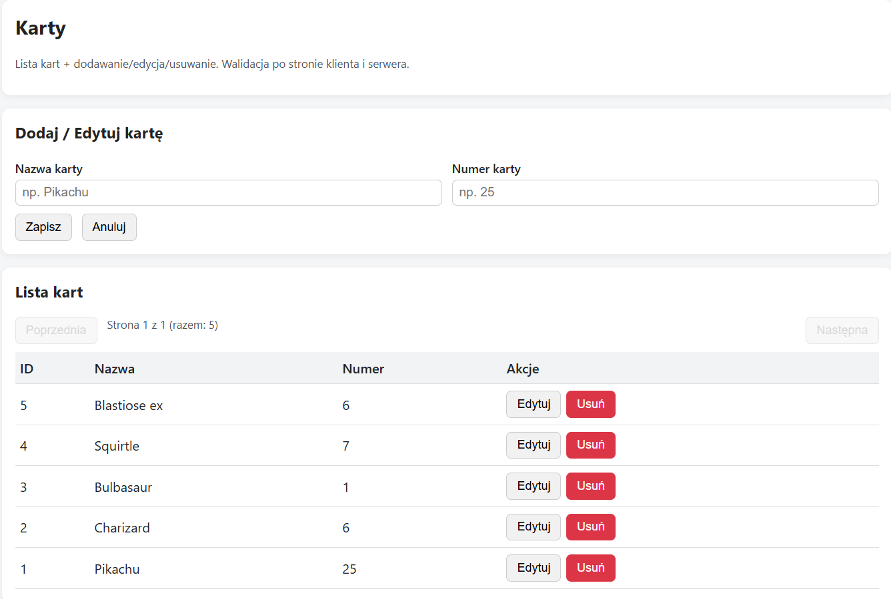
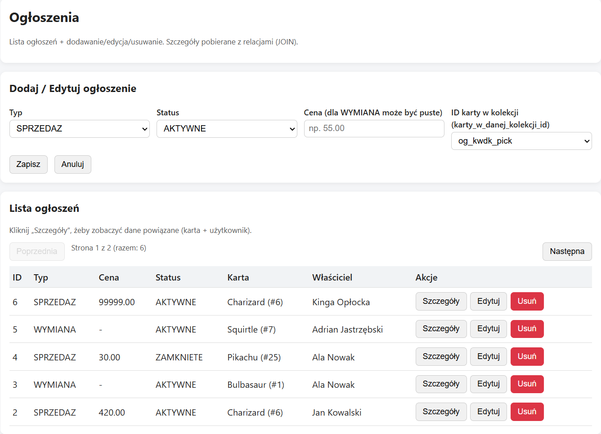
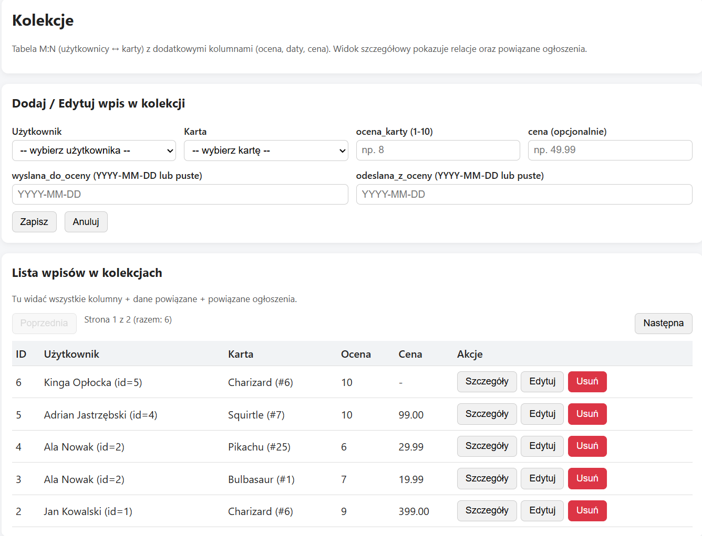
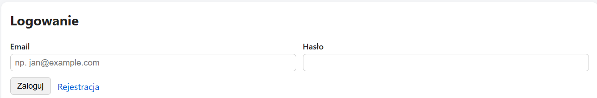
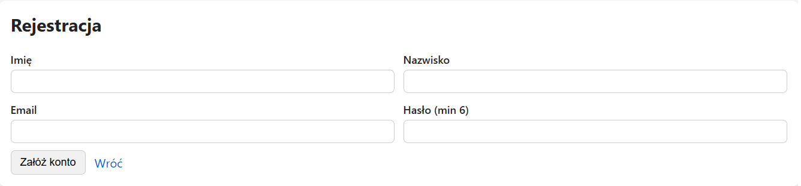

# PokeMonster — Pokémon Collection App

PokeMonster is a full-stack web application designed to manage Pokémon cards, personal card collections, and trading or selling advertisements.

The project combines a **React** frontend, a **Node.js and Express** backend, and a **MySQL** relational database.

## Features

- Browse, add, edit, and delete Pokémon cards.
- Manage personal Pokémon card collections.
- Create and manage card sale and trade advertisements.
- User registration and login interfaces.
- JWT-based authentication and role-based authorization.
- Pagination of cards, collections, and advertisements.
- Client-side and server-side data validation.
- View related card and user information in advertisements.

## Technologies

**Frontend**
- React
- JavaScript
- React Router
- Vite
- CSS

**Backend**
- Node.js
- Express.js
- REST API
- JSON Web Tokens (JWT)

**Database**
- MySQL
- SQL
- Relational database design

## Screenshots

### Pokémon Cards



### Advertisements



### Collections



### Login



### Registration



## Installation

### Requirements

- Node.js and npm
- MySQL Server
- Git

### 1. Clone the repository

```bash
git clone https://github.com/AdrianJastrzebski4/PokeMonster---Pokemon-CollectionApp.git
cd PokeMonster---Pokemon-CollectionApp
```

### 2. Configure the database

Create a MySQL database:

```sql
CREATE DATABASE pokemonster CHARACTER SET utf8mb4 COLLATE utf8mb4_general_ci;
```

Import the database schema and sample data using the scripts provided in the `sql` directory:

```sql
SOURCE sql/01_schema.sql;
SOURCE sql/02_seed.sql;
```

Run these commands from MySQL with the appropriate paths to the SQL files.

### 3. Configure environment variables

Copy `backend/.env.example` to `backend/.env` and configure your local database credentials and JWT secret.

The `.env` file is excluded from Git to avoid exposing sensitive information.

### 4. Start the backend

```bash
cd backend
npm install
node server.js
```

The backend runs by default at `http://localhost:3000`.

### 5. Start the frontend

Open a separate terminal:

```bash
cd frontend-react
npm install
npm run dev
```

Open the URL displayed by Vite, typically `http://localhost:5173`.

## Project Structure

```text
PokeMonster/
├── backend/           # Express REST API
│   ├── middlewares/
│   ├── routes/
│   ├── validators/
│   ├── db.js
│   ├── server.js
│   └── .env.example
├── frontend-react/    # React application
├── sql/               # Database schema and seed data
├── mockups/           # Application mockups
├── screenshots/       # Application screenshots
├── .gitignore
└── README.md
```

## Author

Developed by Adrian Jastrzębski.